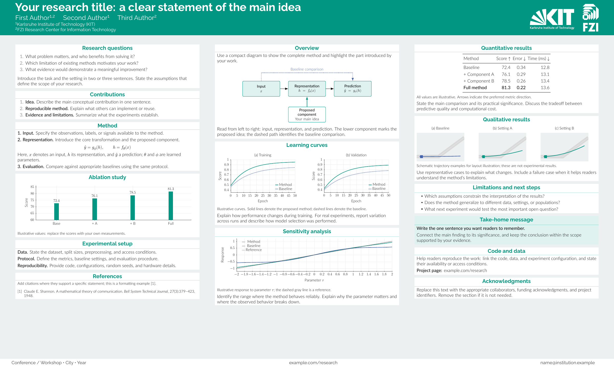
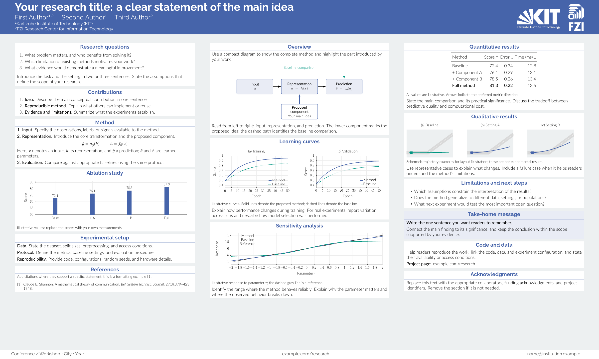
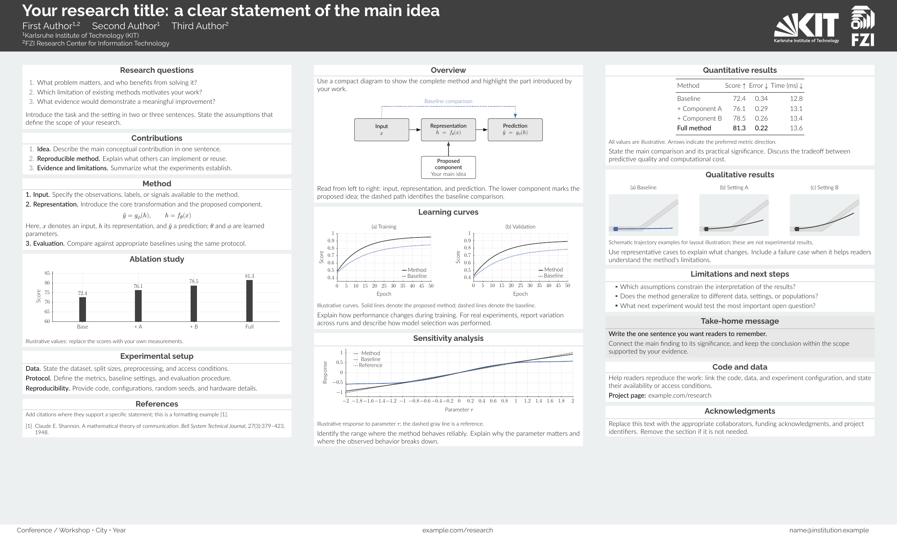
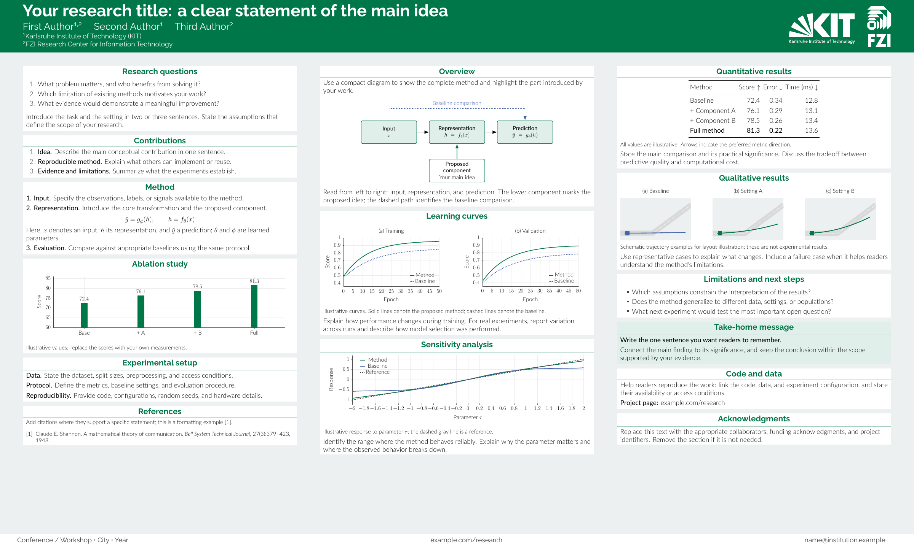

# KIT & FZI research poster template

A landscape LaTeX poster template for **Karlsruhe Institute of Technology (KIT)**
and **FZI Research Center for Information Technology**, built on
[Gemini](https://github.com/anishathalye/gemini).

The template adapts the layout of an existing KIT/FZI research poster with KIT
colors, institutional logos, three columns, and editable figures and tables.
The default page size is **120 × 72 cm**. All example plots and result values are
illustrative; replace them with your own research.

## Color options

The same layout is available in three KIT colors and FZI green. Click a preview
to view the full-size PNG.

| KIT green (default) | KIT blue |
| --- | --- |
| [](assets/preview/colors/kit-green.png) | [](assets/preview/colors/kit-blue.png) |
| **KIT black 70%** | **FZI green** |
| [](assets/preview/colors/kit-black70.png) | [](assets/preview/colors/fzi-green.png) |

Choose a palette near the top of [`poster.tex`](poster.tex):

```tex
\providecommand{\kitfzipalette}{kit-green}
\providecommand{\kitfzicolormodel}{rgb}
```

| Palette ID | RGB | CMYK (%) |
| --- | --- | --- |
| `kit-green` | 0 / 150 / 130 | 100 / 0 / 60 / 0 |
| `kit-blue` | 70 / 100 / 170 | 80 / 50 / 0 / 0 |
| `kit-black70` | 64 / 64 / 64 | 0 / 0 / 0 / 70 |
| `fzi-green` | 0 / 119 / 73 (`#007749`) | Not verified |

The KIT values follow the [KIT corporate color specifications](https://kit-cd.km.kit.edu/341.php).
The default `rgb` model uses the supplied RGB values for screen previews.
For the KIT palettes, set `\kitfzicolormodel` to `cmyk` to use the supplied print
values. Official RGB and CMYK specifications are separate color definitions;
their on-screen appearance can differ.

FZI green uses `#007749`. The FZI primary color remains RGB
even when the KIT color model is set to `cmyk`.

## Build

Requires LuaLaTeX, latexmk, and the Raleway and Lato fonts (available in TeX Live
or MacTeX).

```sh
make                 # Build poster.pdf
make color-previews  # Refresh the four-color gallery
```

PNG rendering uses Poppler (`pdftoppm`) or macOS `sips`.

## License and logos

Gemini and the template code are distributed under the
[MIT License](LICENSE.md). Institutional logos retain their respective rights
and are separate from the code license. See the
[logo sources and usage notes](assets/logos/README.md).
